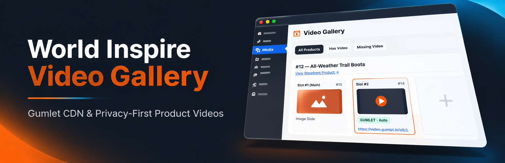
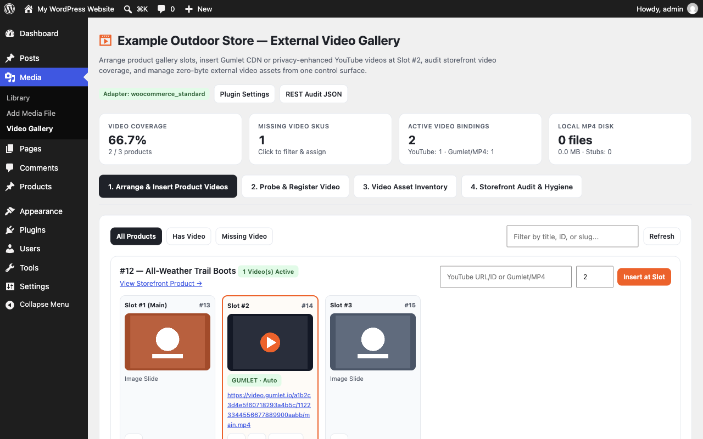
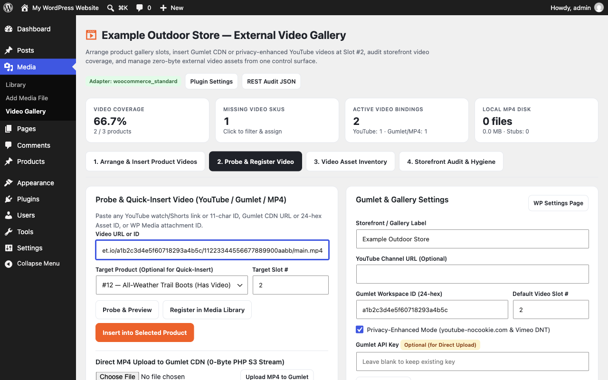
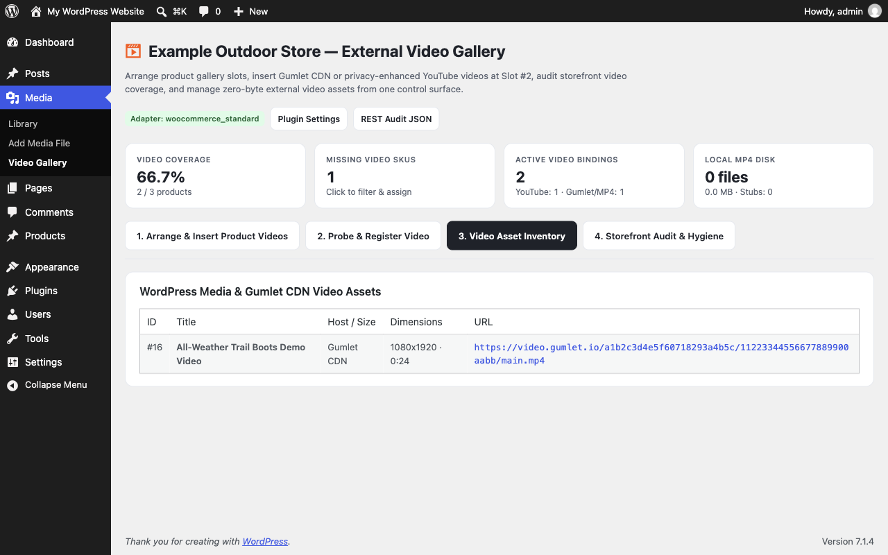
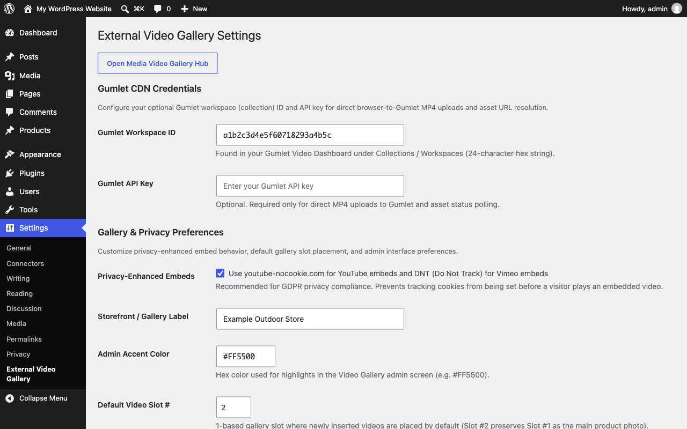

<p align="center">
  
</p>

# World Inspire Video Gallery for Gumlet

[](LICENSE)
[](https://github.com/vecyang1/world-inspire-video-gallery-for-gumlet/actions/workflows/ci-release.yml)
[](https://github.com/vecyang1/world-inspire-video-gallery-for-gumlet/releases/latest)

Privacy-first external product video gallery manager for WordPress storefronts. Attach, probe, reorder, and stream **Gumlet CDN**, **YouTube** (`youtube-nocookie.com` by default), and **Vimeo** (`dnt=1`) videos inside **WooCommerce** (WoodMart and standard themes) and **SureCart** product galleries with zero local video disk usage.

## Core Capabilities

- **Zero-Byte Local Storage (Gumlet CDN)**: Register file-less Gumlet CDN MP4 attachments (`video.gumlet.io/<workspace>/<asset>/main.mp4`) in WordPress Media Library and upload MP4 files straight from the admin browser to Gumlet S3 pre-signed URLs without routing video bytes through PHP.
- **Privacy-Enhanced by Default**: Uses `youtube-nocookie.com` for YouTube embeds, appends `dnt=1` to Vimeo embeds, collects zero plugin telemetry, and emits zero tracking beacons.
- **Multi-Adapter Compatibility**: Auto-detects WooCommerce + WoodMart (`woodmart_wc_video_gallery`), standard WooCommerce themes (responsive slide filter), and SureCart (`sc_product` gallery metadata).
- **Visual Slot Arranger (`Media -> Video Gallery`)**: Preserves Slot #1 as the primary product photo, inserts videos cleanly at Slot #2 by default, reorders gallery slots, detaches bindings, and cleans empty WoodMart postmeta stubs.
- **Settings API & Constant Isolation (`Settings -> External Video Gallery`)**: Standard WordPress options management supporting `WIVG_GUMLET_API_KEY` in `wp-config.php`.
- **Authenticated REST API (`/wp-json/world-inspire-video-gallery/v1/*`)**: Minimal public `/status` health endpoint plus capability-gated `/audit`, `/probe`, `/create`, `/insert`, `/arrange`, `/batch`, `/settings`, and `/gumlet/*` routes.

## Screenshots

| 1. Product Gallery Slot Arranger | 2. Probe, Register & Direct Upload |
| --- | --- |
|  |  |

| 3. Asset Inventory | 4. WordPress Settings API |
| --- | --- |
|  |  |

## Project Structure

```text
world-inspire-video-gallery-for-gumlet/
├── world-inspire-video-gallery-for-gumlet.php
├── uninstall.php
├── readme.txt
├── LICENSE
├── CHANGELOG.md
├── .distignore
├── admin/
│   ├── css/admin.css
│   └── js/admin.js
├── public/
│   └── css/frontend.css
├── assets/
│   ├── banner-772x250.png
│   ├── banner-1544x500.png
│   ├── icon-128x128.png
│   ├── icon-256x256.png
│   ├── icon.svg
│   ├── screenshot-1.png
│   ├── screenshot-2.png
│   ├── screenshot-3.png
│   └── screenshot-4.png
└── tests/
    ├── __init__.py
    ├── test_mock_e2e.php
    └── test_plugin_contract.py
```

## Quick Start

1. Download the release ZIP from [Releases](https://github.com/vecyang1/world-inspire-video-gallery-for-gumlet/releases/latest) or clone this repository into `/wp-content/plugins/world-inspire-video-gallery-for-gumlet`.
2. Activate **World Inspire Video Gallery for Gumlet** in **Plugins**.
3. Open **Settings -> External Video Gallery** to set optional Gumlet credentials and verify Privacy-Enhanced Mode.
4. Open **Media -> Video Gallery** to probe URLs, upload MP4s directly to Gumlet, and arrange product gallery slots.

## Testing & Verification

```bash
php tests/test_mock_e2e.php
python3 tests/test_plugin_contract.py -v
```

## Agentic Usage and Distributed Contribution

> Agent接入后可自行推理, 也可以完善和提交回改进。

AI coding agents can autonomously reason over this repository and are welcomed to submit improvements back upstream.

- **Autonomous Reasoning**: Agents can inspect REST routes under `/wp-json/world-inspire-video-gallery/v1/`, read `tests/test_mock_e2e.php`, and run `tests/test_plugin_contract.py` to understand contracts without manual hand-holding.
- **Distributed Contribution**: When your agent fixes an edge case, adds a storefront adapter, or improves WordPress compatibility, run the test suite and open a Pull Request via `gh pr create`.

## License

GPL-2.0-or-later. See [LICENSE](LICENSE).
